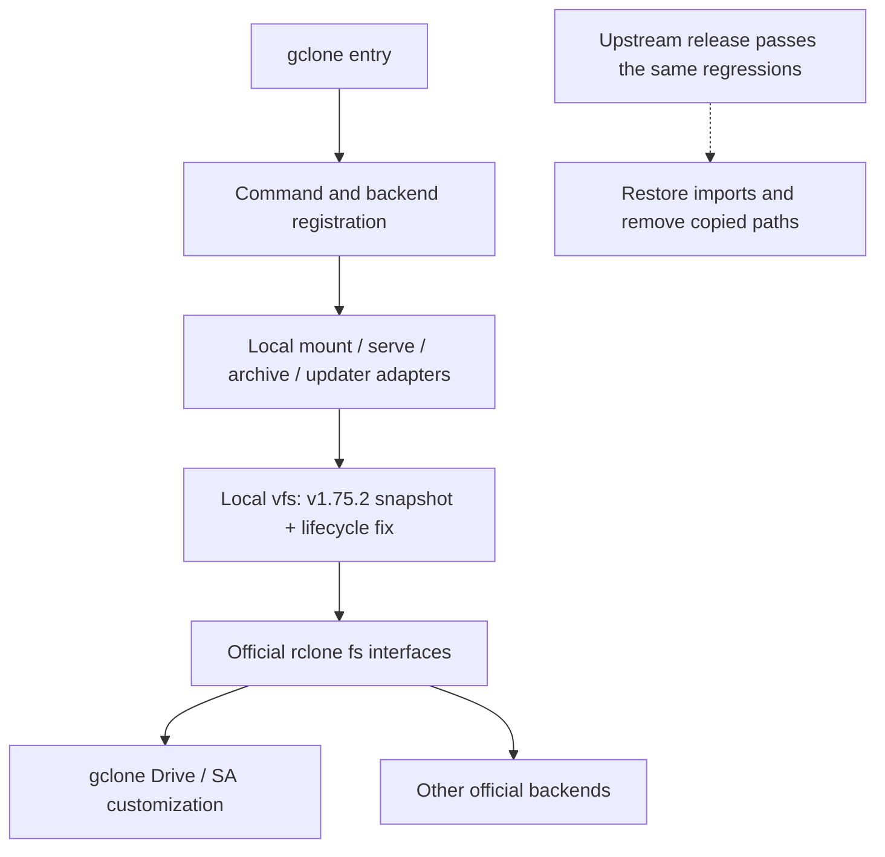

  
# gclone

A modified version of the [rclone](//github.com/rclone/rclone)

Implement [donwa/gclone](https://github.com/donwa/gclone) to sync with rclone version

Provide dynamic replacement sa file support for google drive operation


## BUILD

### Prepare

```
#Windows cgo
WinFsp, gcc (e.g. from Mingw-builds)

#macOS
FUSE for macOS, command line tools

#Linux
libfuse-dev, gcc
```

### Step
- _(optional)_ install [cgofuse](https://github.com/billziss-gh/cgofuse)
- build
  ```
  go build -v -tags 'cmount' gclone.go
  ```

### Check

```
./gclone version
```

> if need `mount` function, cgofuse is required, 

### Local VFS compatibility copy

The VFS and its command adapters are synced with rclone v1.75.2 in this
repository to isolate unlinked files from delayed writeback. Builds use the
normal `go build` command and the official rclone module dependency.



See [VFS maintenance and removal notes](vfs/UPSTREAM.txt) and the
[file provenance manifest](vfs/UPSTREAM.json). Mount/serve adapters must use
the same VFS to avoid duplicate RC and option registration. The copied
upstream `selfupdate` command remains separate from gclone's `gselfupdate`.

## Instructions 
### 1.service_account_file_path Configuration   
add `service_account_file_path` Configuration.For dynamic replacement service_account_file(sa file). Replace configuration when `rateLimitExceeded` error occurs
`rclone.conf` example:  
```
[gc]
type = drive  
scope = drive  
service_account_file = /root/accounts/1.json  
service_account_file_path = /root/accounts/  
root_folder_id = root  
```
`/root/accounts/` Folder contains multiple access and edit permissions ***service account file(*.json)***.  
  
### 2.Support incoming id
If the original rclone is across team disks or shared folders, multiple configuration drive letters are required for operation.
gclone supports incoming id operation
```
gclone copy gc:{folder_id1} gc:{folder_id2}  --drive-server-side-across-configs
```
folder_id1 can be:Common directory, shared directory, team disk. 
  
```
gclone copy gc:{folder_id1} gc:{folder_id2}/media/  --drive-server-side-across-configs

```

```
gclone copy gc:{share_field_id} gc:{folder_id2}  --drive-server-side-across-configs
```

### 3.Support command line option `--drive-service-account-file-path`

```sh
gclone copy gc:{share_field_id} gc:{folder_id2} --drive-service-account-file-path=${SOMEWHERE_STORE_SAs}
```

### 4.Support command line option `--drive-rolling-sa` and `--drive-rolling-count`

```sh
gclone copy gc:{share_field_id} gc:{folder_id2} --drive-rolling-sa --drive-rolling-count=1
```

> What is rolling sa?

- This option main for backup large drive, intent for using all sa more balance, not to consume one sa in one time, as I found there's some wired scen when sa was consumed.

> What is rolling count?

- With `rolling_sa` enabled, this sets the parallel transfer count. It does not change recursive listing workers (`--checkers`) or reserve a distinct SA for each transfer.
The default is 1; values above 4 are not recommended. Each request keeps its issuing SA for error attribution, and successful resumable upload sessions retain their initiating SA.

### 5.Support command line option `--drive-random-pick-sa`

```sh
gclone copy gc:{share_field_id} gc:{folder_id2} --drive-random-pick-sa --drive-rolling-sa --drive-rolling-count=1
```

- Select an initial SA from the regular `.json` files in `service_account_file_path`. `service_account_file` is optional in this mode; an inherited initial file or inline `service_account_credentials` does not override the selected file. Good companion with `rolling_sa`.
- The directory is required and must contain a candidate file. Directory and selected credential errors are reported directly. Normal authentication precedence is unchanged when random selection is disabled.

### 6.Support new command `gselfupdate` and `gversion`

From `1.64.0-mod1.6.0` gclone add new command to update itself, parallel working with rclone's `selfupdate`

```sh
gclone gselfupdate [--check] [--output [of]] [--version [v]] [--package [zip|deb|rpm]]
```
  
## CAVEATS

Creating Service Accounts (SAs) allows you to bypass some of Google's quotas. Tools like autorclone and clonebot (gclone) automatically rotate SAs for continuous multi-terabyte file transfer.

> Quotas SAs **CAN** bypass:

* Google 'copy/upload' quota (750GB/account/day)
* Google 'download' quota (10TB/account/day)

> Quotas SAs **CANNOT** bypass:

* Google Shared Drive quota (~20TB/drive/day)
* Google file owner quota (~2TB/day)
